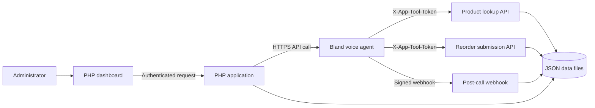

# Brand X Mobile | AI Retail Account Manager

> **Try the live demo:** [Open Brand X Mobile Retail Call Demo](https://firstnormalform.com/code/brandx/)
>
> The dashboard is a guided demo: run a mock call instantly, or place a live call only to a number you approved. It uses fictional stores and phone inventory; reorder requests are for human review, not purchases.

A portfolio project demonstrating a voice agent completing a structured retail check-in: discuss phone inventory, look up product facts, capture a proposed reorder, and route it for human review.

The application combines a PHP dashboard and API with a Bland voice agent. The demo uses fictional stores and products. Live calls can be placed only to numbers an administrator has explicitly approved; a submitted reorder is a review request, never a purchase order.

## Product walkthrough

An administrator selects a fictional store and starts either a deterministic mock scenario or an explicitly approved live call. During a live conversation, the agent can retrieve product information and submit a reorder request through authenticated application endpoints. The dashboard then displays the call outcome and any request awaiting review.

The mock experience is self-contained and does not contact Bland, use a phone number, or require network access. It supports five outcomes: confirmed reorder, decline, unavailable product, human follow-up, and busy retailer.

In a live call, the recipient can choose how to respond. The agent can collect a requested SKU and quantity and ask for explicit confirmation; acknowledge that the retailer has enough stock and end the call; explain when a requested product is unavailable; route discount or delivery questions to a human; or offer human follow-up when the retailer is busy. The agent submits a reorder request only after the retailer confirms the read-back. The mock scenario selector controls only simulated calls; it does not choose the live caller's response.

## System design



The application owns business rules and persistence. It validates store and SKU identifiers, phone-model availability, whole-unit quantities, explicit caller confirmation, and duplicate submissions by call ID. Bland handles the spoken conversation and invokes tools; the application’s tool responses remain authoritative.

## Engineering highlights

- Separate mock and live paths, with the mock path available without external services.
- Server-side session authentication and CSRF protection for dashboard actions.
- Live calls require an administrator action and a number on the approved demo list.
- API credentials remain server-side. Agent tools use a separate shared secret, and post-call webhooks are verified with HMAC-SHA256.
- Reorder writes are validated, locked, and atomically persisted; repeat submissions for a call ID are rejected.
- A request is recorded as **Pending human review** only after the caller confirms the details. The app does not represent it as a completed order.

## Run locally

Requirements: PHP 8.1 or later. cURL is needed only for live Bland calls. The project has no Composer dependencies, database, Node.js toolchain, or build step.

From the repository root, start PHP’s development server:

```powershell
php -S 127.0.0.1:8787 -t public
```

Open [http://127.0.0.1:8787](http://127.0.0.1:8787) and sign in with the local-only password `demo`. Select a store and choose **Run mock demo**. Before hosting, configure a strong `APP_ADMIN_PASSWORD`; do not use the local default on a deployed instance.

The mock demo writes fictional call and reorder activity to the local JSON files under `storage/`.

## Live Bland integration

Live mode requires a published Bland agent, public HTTPS endpoints, configured secrets, and at least one approved test recipient. The dashboard readiness checklist must be complete before the live-call action is enabled. The app does not create agents, buy numbers, publish agent versions, or initiate calls automatically.

See [Bland agent setup](docs/bland-setup.md) for agent configuration, webhook tools, deployment, and troubleshooting. See [deployment notes](docs/deployment.md) and [architecture notes](docs/architecture.md) for hosting and implementation details.

## API surface

All endpoints return JSON.

| Endpoint | Purpose | Access control |
| --- | --- | --- |
| `GET /api/status.php` | Read mode and readiness status | Admin session |
| `GET /api/accounts.php` | List fictional stores | Admin session |
| `GET /api/activity.php` | Read calls and reorder activity | Admin session |
| `GET /api/test-numbers.php` | List approved demo numbers | Admin session |
| `POST /api/test-numbers.php` | Add an approved number | Admin session, CSRF token, consent confirmation |
| `DELETE /api/test-numbers.php` | Remove an approved number | Admin session, CSRF token |
| `POST /api/demo.php` | Run a simulated conversation | Admin session, CSRF token |
| `POST /api/call.php` | Place one configured live call | Admin session, CSRF token, approved number |
| `GET /api/products.php` | Return product facts to a Bland tool | `X-App-Tool-Token` |
| `POST /api/reorders.php` | Validate and save a confirmed review request | `X-App-Tool-Token` |
| `POST /api/webhook.php` | Receive post-call results | Bland HMAC-SHA256 signature |

A reorder request includes a store ID, call ID, confirmation flag, and one or more SKU/quantity-units pairs. The API rejects invalid or unavailable models, malformed quantities, missing confirmation, and duplicate call IDs.

## Verification

Run the backend checks with:

```powershell
php tests/test-reorders.php
```

The checks cover reorder validation and idempotency, webhook signature handling, API-key configuration failure, and concurrent duplicate submissions. Conversational cases are documented in [tests/scenarios.json](tests/scenarios.json). Automated checks do not substitute for a live call evaluation with a consenting test recipient.

## Scope and limitations

The seeded catalog and stores are fictional. Reorder requests are saved for human review; the application does not validate negotiated pricing, promise delivery, create purchase orders, or fulfill orders. JSON storage with file locking is intended for a low-volume, single-server demonstration and is not a distributed or high-throughput database.

The demo catalog uses Apple iPhone 17, iPhone 17 Pro Max, and iPhone 17 Pro. Counterpoint Research listed these as the top three smartphone models by global sales in Q2 2026; the demo's specific stores, availability, and stock are fictional. [Counterpoint Research](https://counterpointresearch.com/insights/iphone-17-global-best-selling-smartphone-in-q2-2026)

## Repository map

```text
public/       Dashboard, styles, browser code, and API endpoints
src/          Configuration, storage, and application services
storage/      Fictional seed data and local activity records
bland/        Agent prompt and webhook tool configuration
docs/         Architecture, deployment, and Bland setup guides
 tests/       Backend checks and conversational scenarios
.env.example  Environment variable template
```

