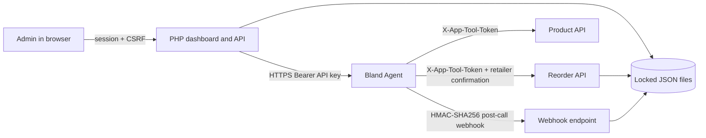

# Architecture

The PHP app owns data integrity: product availability, store IDs, reorder quantities, explicit confirmation, idempotency, and persistence. Bland owns speech, conversation flow, interruption handling, and invoking tools. The tool responses are the source of truth; the assistant must not make up business facts or report success before PHP confirms it.

The UI exposes a mock path with no network calls, and a separate live path. Live mode is hidden until the API key, published agent, public HTTPS URL, signing secret, tool token, and at least one approved recipient are configured. Calls are individually started by an administrator and use an outbound cooldown.

JSON files are protected by a separate lock file and written to a temporary file before replacement. This is adequate for a single low-volume demo server. It is not designed for distributed or high-throughput writes.
